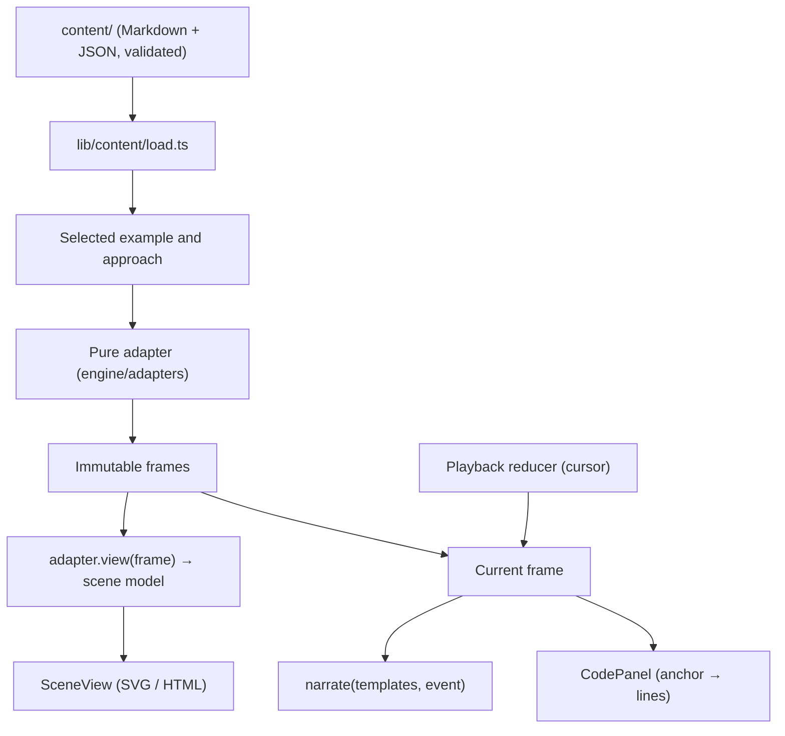

# Architecture

Every lesson runs from one deterministic algorithm trace. The current frame controls the diagram, the explanation, the variables and the highlighted code line. Animation only moves between frames; it never decides what the algorithm does.

## The six layers

| Layer | Where | Does | Never does |
| --- | --- | --- | --- |
| Problem content | `content/` | Story, statement, explanation, examples, narration templates, checkpoints, reference code | Run code |
| Algorithm adapter | `src/engine/adapters/*.ts` | Validate input, emit semantic frames, project a frame onto a scene model | Touch the DOM, timers or React state |
| Trace model | `src/engine/contracts/` | `TraceFrame`, `TraceResult`, `createTracer` (copy and freeze every frame) | Hold DOM nodes or components |
| Presenter | `src/engine/narrate.ts` | Pick the reviewed template for the frame's event (and variant) and fill in its values | Recompute algorithm state |
| Scene renderer | `src/visuals/scenes/` | Draw arrays, graphs, stacks and queues from a scene model | Decide the next step |
| Playback controller | `src/features/player/reducer.ts`, `PlayerProvider.tsx` | Cursor, play/pause, seek, speed, checkpoints, one scheduler | Infer correctness from time |

### Adapters

An adapter (`AlgorithmAdapter<I, S, E, O>`) declares:

- `events`: each event kind with its code anchor, the fields it carries and any variants. Validation uses this to check narration templates and reference code.
- `parseInput(raw)`: field-specific errors, never a throw. Approach-specific preconditions live here. For example, opposite pointers rejects unsorted prices with a message, instead of silently sorting and changing the indices.
- `trace(input)`: pure and deterministic. Frames get ids like `4-compare-sum`, which checkpoints reference.
- `view(frame, { input, frames, display })`: a pure projection onto a reusable `SceneModel` (`arrays`, `graph`, `stack`, `queue`, `legend`) plus variables, facts and a plain-text summary. It receives the whole trace so geometry can stay fixed for the run: stack height and queue length are sized from the largest frame.

Seven adapters exist. One problem can have several approaches; the voucher lesson has *check every pair* and *opposite pointers*. One renderer serves many adapters: `ArrayScene` draws two-pointer, window, prefix-sum, palindrome and bracket inputs.

### Running a lesson

- At build time, the problem page traces only the **default approach and first example**, and embeds that run with its views. The first walkthrough appears in the static HTML with no JavaScript needed to draw it.
- Any other example, approach or custom input loads that adapter on demand (`engine/registry/client.ts`, one chunk per adapter) and calls `prepareRun`, the same function used at build time. Runs are cached by approach, example, adapter version and input. A request whose reply arrives after a newer request is ignored.
- `FRAME_CAP` (2,000) bounds every trace. Inputs are also bounded per adapter. Over the cap, the learner gets an honest message, never a truncated trace.

### Playback

`playerReducer` is pure and unit-tested:

- Previous and next move exactly one frame. Seek clamps, snaps and pauses.
- Loading a new run resets the cursor and increments `runId`.
- A checkpoint on the current frame blocks `next`, `play` and autoplay until it is answered or skipped. An answer saved in local progress clears it on later visits, which acts as review mode.
- `previous` is recorded, so a jump of more than one frame renders without animation.
- `source` (`manual` or `auto`) decides what the polite live region announces. Autoplay is not announced step by step.

There is one scheduler: a `setTimeout` effect keyed on `playing`, `cursor`, `speed` and `runId`. Every change cancels the pending timer before a new one is set. Playback pauses when the tab is hidden. Nothing autoplays on arrival.

### Rendering and motion

Arrays and graphs are SVG with fixed geometry per run, and pointers are keyed groups moved with CSS `transform` transitions (240 ms). Stacks and queues are ordered HTML lists. `prefers-reduced-motion` removes every transition; the state still updates. Wide scenes scroll inside their own container, so the page never scrolls sideways.

## Content pipeline

`src/lib/content/load.ts` reads `content/`, parses it with zod schemas (`schema.ts`), renders Markdown with raw HTML escaped and links checked (`markdown.ts`), parses reference code and its anchors (`code.ts`), and then runs every approach on every example. `getSite()` throws on any error, so `next build` fails rather than ship a broken lesson. `publishedOnly()` removes drafts and any membership that points at a draft pattern; every public page reads only from it.

## Routes

| Route | Built from |
| --- | --- |
| `/` | Introduction plus a live compact walkthrough of the voucher lesson |
| `/patterns/` | `PatternCatalog`: search with aliases, topic and progress filters in the URL |
| `/patterns/[slug]/` | Pattern sections, a static scene, variants, lessons in order, honest empty state |
| `/problems/[slug]/` | `Workspace`: Understand, Visualize, Practice |
| `/practice/` | `PracticeCatalog`, grouped by pattern, filters in the URL, cards on phones |
| `/paths/[slug]/` | Ordered curriculum; mixed review hides pattern names until revealed |
| `/my-learning/` | Local progress, export and clear |
| `/authoring/` | Development only: drafts, validation results, raw frame beside the public player |

Layout: from 1200 px the lesson is a 220 px rail, a reading column and a larger stage. Between 900 and 1199 px the rail becomes a "Lesson outline" drawer. Below 900 px everything stacks; in Visualize and Practice the stage comes first.

## Progress

`src/lib/progress/model.ts` keeps one record per **canonical problem id**, with separate milestones: story read, walkthrough explored, prediction answered, practised, review requested. A problem that appears in two patterns therefore has one record. Pattern progress is always derived, never stored. `localRepository.ts` writes versioned JSON to `localStorage` (debounced, flushed on `pagehide`), survives storage failure by keeping progress in memory for the tab, and syncs across tabs.

## Extension points

- **Accounts:** implement `ProgressRepository` against a server API and swap it in `ProgressProvider`. Suggested tables: `user_progress`, `bookmarks`, `attempts`, `checkpoint_answers`, `notes`. Merging anonymous progress into an account should be idempotent.
- **Code judging:** a separate service with isolated, disposable workers and server-side hidden tests. Never run learner code in the page or in a Web Worker as a "sandbox". The Practice panel is where a runner would plug in.
- **More scenes:** add a model shape to `visuals/scenes/model.ts` and a renderer to `SceneView`. Matrix and call-stack scenes would follow the same pattern.
- **CMS:** content is plain files with a schema, so an editor can write the same files. Executable content (MDX, scripts) is deliberately not supported.
